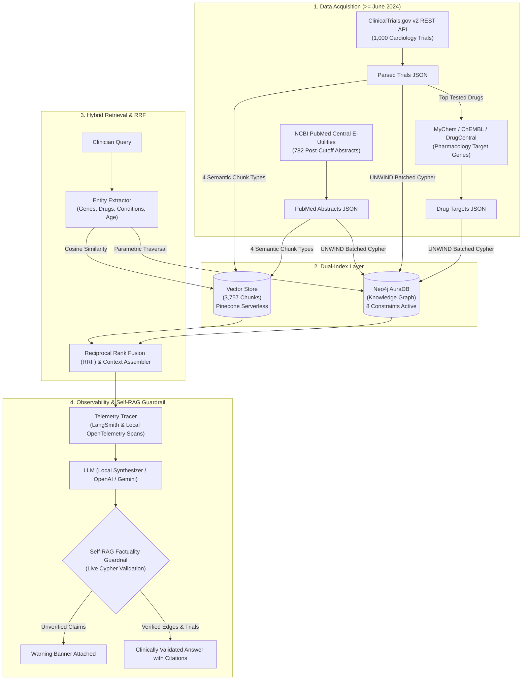

# 🫀 Cardiology Clinical Trial & Pharmacology GraphRAG Copilot

[](https://www.python.org/downloads/release/python-3110/)
[](https://fastapi.tiangolo.com/)
[](https://docs.pytest.org/)
[](https://smith.langchain.com/)
[](https://neo4j.com/cloud/platform/aura-graph-database/)
[](https://streamlit.io/)
[](https://github.com/your-username/clinical-trial-rag-copilot/actions)
[](https://opensource.org/licenses/MIT)

An enterprise-grade, production-ready **GraphRAG Copilot** designed for cardiology clinical trial feasibility and drug discovery pharmacology. It addresses the fundamental failures of traditional vector search by uniting a **deterministic Neo4j Knowledge Graph** with a **dense vector store**, protected by a **Self-RAG Knowledge Graph Factuality Guardrail**, full **LangSmith observability**, and a **FastAPI REST service**.

---

## 📌 Why GraphRAG Over Flat Vector RAG?

| Challenge | Flat Vector RAG | Dual-Indexed GraphRAG (Our Solution) |
| :--- | :--- | :--- |
| **Numeric & Relational Filters** | Cannot evaluate inequalities ($Age \ge 65$) or multi-hop joins across datasets. | **Deterministic Cypher Queries**: Filters exact demographic bounds and joins Trials $\to$ Arms $\to$ Drugs $\to$ Genes. |
| **Placebo vs. Active Drug Conflation** | Treats all mentioned interventions uniformly in chunk text. | **Isolates Study Arms**: First-class `(:ArmGroup)` nodes distinguish `EXPERIMENTAL` vs. `PLACEBO_COMPARATOR`. |
| **LLM Pretraining Contamination** | LLMs answer from memorized weights, masking retrieval failures. | **Post-Cutoff Data ($\ge \text{June 2024}$)**: Guarantees objective evaluation on unseen clinical data. |
| **Hallucinated Interactions** | Generates plausible-sounding but fictitious drug mechanisms. | **Self-RAG Guardrail**: Validates every claimed drug-gene edge and NCT identifier against live graph ground truth. |
| **Silent System Crashes** | Naive pipelines break if a cloud DB hibernates or pauses. | **Resilient Circuit Breaker**: Gracefully degrades to dense vector search with automated health reporting. |

---

## 🏗️ Architecture & Dual-Indexing Flow



---

## 🔍 Observability & Telemetry (LangSmith & Local Spans)

Every query is instrumented with fine-grained span telemetry capturing step-by-step latencies, token consumption, and retrieval outputs:
- **Native LangSmith Cloud**: Set `LANGCHAIN_TRACING_V2=true` and `LANGCHAIN_API_KEY` to stream traces live to the LangSmith dashboard.
- **Local JSON Spans**: Automatically logs structured OpenTelemetry-compatible traces in `data/output/traces/{trace_id}.json`.
- **Latency Breakdown**:
  - `hybrid_retrieval`: ~1.6s
  - `prompt_assembly`: <1ms
  - `llm_synthesis`: Provider-dependent (sub-second local)
  - `self_rag_guardrail`: ~30ms

---

## 🧪 Comprehensive Automated Testing (15/15 PyTest Passed)

Run the full automated test suite:
```bash
uv run pytest -v
```

```text
============================= test session starts =============================
tests/test_api.py::test_api_health_check PASSED                          [  6%]
tests/test_api.py::test_api_query_endpoint PASSED                        [ 13%]
tests/test_api.py::test_api_guardrail_verify_endpoint PASSED             [ 20%]
tests/test_api.py::test_api_traces_endpoint PASSED                       [ 26%]
tests/test_chunking.py::test_create_trial_chunks PASSED                  [ 33%]
tests/test_chunking.py::test_create_literature_chunk PASSED              [ 40%]
tests/test_chunking.py::test_build_all_chunks PASSED                     [ 46%]
tests/test_data_processing.py::test_clean_drug_name PASSED               [ 53%]
tests/test_data_processing.py::test_parse_age_to_years PASSED            [ 60%]
tests/test_data_processing.py::test_split_eligibility_criteria PASSED    [ 66%]
tests/test_data_processing.py::test_split_criteria_missing_exclusion PASSED [ 73%]
tests/test_guardrail.py::test_guardrail_extracts_entities PASSED         [ 80%]
tests/test_guardrail.py::test_guardrail_resilient_handling PASSED        [ 86%]
tests/test_vector_store.py::test_vector_store_build_and_search PASSED    [ 93%]
tests/test_vector_store.py::test_vector_store_persistence PASSED         [100%]

============================= 15 passed in 4.85s ==============================
```

---

## 🌐 Production FastAPI Service & Swagger Documentation

An asynchronous REST API is ready for enterprise deployment:
```bash
uv run uvicorn clinical_trial_rag_copilot.api.main:app --host 0.0.0.0 --port 8000 --reload
```
Interactive Swagger documentation is available at: **`http://localhost:8000/docs`**

### REST API Endpoints:
- `GET /api/v1/health`: Real-time system health and index readiness.
- `POST /api/v1/query`: Multi-hop GraphRAG query with full latency breakdown and citations.
- `POST /api/v1/guardrail/verify`: Standalone endpoint to audit any clinical text against Knowledge Graph ground truth.
- `GET /api/v1/traces`: Inspect recent telemetry execution traces.

---

## 📊 Live Knowledge Graph Metrics (Neo4j AuraDB)

| Node Label | Count | Relationship Type | Count |
| :--- | :--- | :--- | :--- |
| **`(:Trial)`** | **1,804** | `[:TARGETS_CONDITION]` | **4,198** |
| **`(:ArmGroup)`** | **1,736** | `[:SPONSORED_BY]` | **1,804** |
| **`(:Condition)`** | **1,421** | `[:HAS_ARM]` | **1,736** |
| **`(:Drug)`** | **1,276** | `[:ADMINISTERS]` | **1,658** |
| **`(:Sponsor)`** | **883** | `[:TESTS_DRUG]` | **1,521** |
| **`(:Paper)`** | **789** | `[:CITES_DRUG]` | **368** |
| **`(:Gene)`** | **196** | `[:STUDIES_GENE]` | **320** |
| **`(:AdverseEvent)`** | **6** | `[:INHIBITS]` | **300** |
| | | `[:REPORTS_ADVERSE_EVENT]` | **293** |

---

## 🚀 Quickstart

### 1. Installation
```bash
git clone https://github.com/your-username/clinical-trial-rag-copilot.git
cd clinical-trial-rag-copilot
uv sync
```

### 2. Configure `.env`
```env
NEO4J_URI=neo4j+s://dd92fb21.databases.neo4j.io
NEO4J_USERNAME=dd92fb21
NEO4J_PASSWORD=your_password

# Observability (Optional):
LANGCHAIN_TRACING_V2=true
LANGCHAIN_API_KEY=lsv2_pt_...
LANGCHAIN_PROJECT=clinical-trial-graphrag

# LLM Selection: local (default, 100% free), google, or openai
VECTOR_STORE_PROVIDER=pinecone
PINECONE_API_KEY=your_pinecone_key
PINECONE_INDEX_NAME=clinical-trial-copilot
PINECONE_NAMESPACE=cardiology-bge-small-v1
PINECONE_CLOUD=aws
PINECONE_REGION=us-east-1
EMBEDDING_PROVIDER=fastembed
```

### 3. Execution Commands
```bash
# 1. Run Automated Test Suite
uv run pytest -v

# 2. Run Benchmark Scorecard
uv run python src/clinical_trial_rag_copilot/eval/benchmark.py

# 3. Launch FastAPI REST Service (Swagger at http://localhost:8000/docs)
uv run uvicorn clinical_trial_rag_copilot.api.main:app --port 8000

# 4. Launch Streamlit Web UI (http://localhost:8501)
uv run streamlit run src/clinical_trial_rag_copilot/app/ui.py

# 5. Launch via Docker Compose (both API & UI)
docker-compose up --build -d
```

---

## 📂 Documentation Reference
- [Production & Observability Guide](docs/PRODUCTION_AND_OBSERVABILITY_GUIDE.md)
- [Data Architecture & Graph Schema](docs/DATA_ARCHITECTURE_AND_GRAPH_SCHEMA.md)
- [Vector Chunking & Hybrid Retrieval](docs/VECTOR_CHUNKING_AND_HYBRID_RETRIEVAL.md)
- [System Architecture Roadmap](docs/SYSTEM_GUIDE_AND_EXECUTION_ROADMAP.md)

## Pinecone vector database

Pinecone is the default vector backend. Neo4j remains responsible for graph traversal;
Pinecone stores chunk vectors, text, and metadata for semantic retrieval and sibling lookup.
FastEmbed uses `BAAI/bge-small-en-v1.5` (384 dimensions), runs locally, and downloads the model
on first use. Keep the same embedding model for ingestion and serving. Corpus-fitted TF-IDF
is only supported by the explicit offline local backend.

After setting the environment variables above, rebuild from the source JSON datasets:

```bash
uv sync
uv run python -m clinical_trial_rag_copilot.retrieval.vector_store
```

The ingestion command creates a serverless cosine index if absent, validates dimensions,
and upserts batches with deterministic chunk IDs. No existing index or namespace is deleted.
Upserts replace matching IDs but do not remove stale chunks. Use a fresh namespace for a
replacement dataset; use a fresh index if the embedding dimension changes, and a fresh
namespace if the model changes. Deploy the same settings to API and UI.
Writes are eventually consistent; health reports readiness after records become visible.
Missing credentials or connectivity produce a degraded health response.

For offline development and the existing local tests, set `VECTOR_STORE_PROVIDER=local`
and `EMBEDDING_PROVIDER=local`. Pinecone tests use mocked clients, with no cloud writes.

References: [Pinecone vector APIs](https://docs.pinecone.io/reference/api/2025-04/data-plane/list),
[FastEmbed](https://qdrant.github.io/fastembed/Getting%20Started/).


## Source datasets on Amazon S3

Source JSON can stay in a private S3 bucket. Pinecone and Neo4j remain the query
indexes; this does not rebuild them, migrate them to S3, or schedule refreshes.

1. Create a general-purpose S3 bucket in your EC2 region, keeping Block Public
   Access enabled. Upload the following files into a prefix such as `datasets/current/`:
   `cardiology_trials.json`, `pubmed_cardiology_literature.json`, and
   `drug_targets_pharmacology.json`. Use the S3 console Upload button from the
   computer containing those files. Never upload `.env` or SSH keys.
2. Create an IAM role trusted by EC2 with the following read/write policy (replace
   `YOUR_BUCKET`). Attach it using EC2 > Actions > Security > Modify IAM role.
   No AWS access keys are needed in the application.

```json
{
  "Version": "2012-10-17",
  "Statement": [{
    "Effect": "Allow",
    "Action": ["s3:GetObject", "s3:PutObject"],
    "Resource": "arn:aws:s3:::YOUR_BUCKET/datasets/current/*"
  }]
}
```

3. Install AWS CLI v2 on EC2 using the official instructions:
   https://docs.aws.amazon.com/cli/latest/userguide/getting-started-install.html
   Check `aws --version`.
4. Add to your remote `.env`:

```dotenv
RAG_DATA_S3_URI=s3://YOUR_BUCKET/datasets/current
AWS_DEFAULT_REGION=eu-west-3
```

5. Verify reading without modifying either retrieval index:

```bash
uv run python -c 'from clinical_trial_rag_copilot.data.storage import load_dataset; print({name: len(load_dataset(name)) for name in ("cardiology_trials.json", "pubmed_cardiology_literature.json", "drug_targets_pharmacology.json")})'
```

Vector ingestion, graph ingestion, and retrieval evaluation use the shared loader.
Each call reads the selected object into memory using AWS CLI; source datasets
are not cached on disk. Missing credentials, inaccessible objects, invalid JSON,
and non-array datasets fail explicitly, without local fallback. Local vector
indexes, model caches, and generated reports still use disk space.

Without `RAG_DATA_S3_URI`, the existing local `data/output` source directory is
used. Set `RAG_DATA_DIR` to override that source directory. Acquisition uses the same storage setting and uploads JSON directly from memory
to S3 when configured. Weekly refresh scheduling is deferred.
Do not rerun ingestion just to test S3 access: it writes to Pinecone or Neo4j.

### Fetch directly into S3

With `RAG_DATA_S3_URI` configured and an EC2 role allowing `s3:PutObject` as well
as `s3:GetObject` on the selected prefix, run:

```bash
uv run python -m clinical_trial_rag_copilot.data.run_acquisition
```

This fetches the three sources and uploads each processed JSON array directly
from memory to S3. It does not first save a JSON file on EC2. Reads for ingestion
and evaluation use those same object names. Without S3 configuration, acquisition
retains local output behavior and honors `RAG_DATA_DIR`.

The three uploads happen sequentially and overwrite existing objects at that
prefix. This is not a transactional release or a backup pipeline; fetching may
still return partial results under the existing source error handling. Use a new
prefix for a fresh collection if you want to preserve your previous dataset.
Fetching does not automatically update Pinecone or Neo4j. No live acquisition or
S3 upload is performed by the automated tests.
