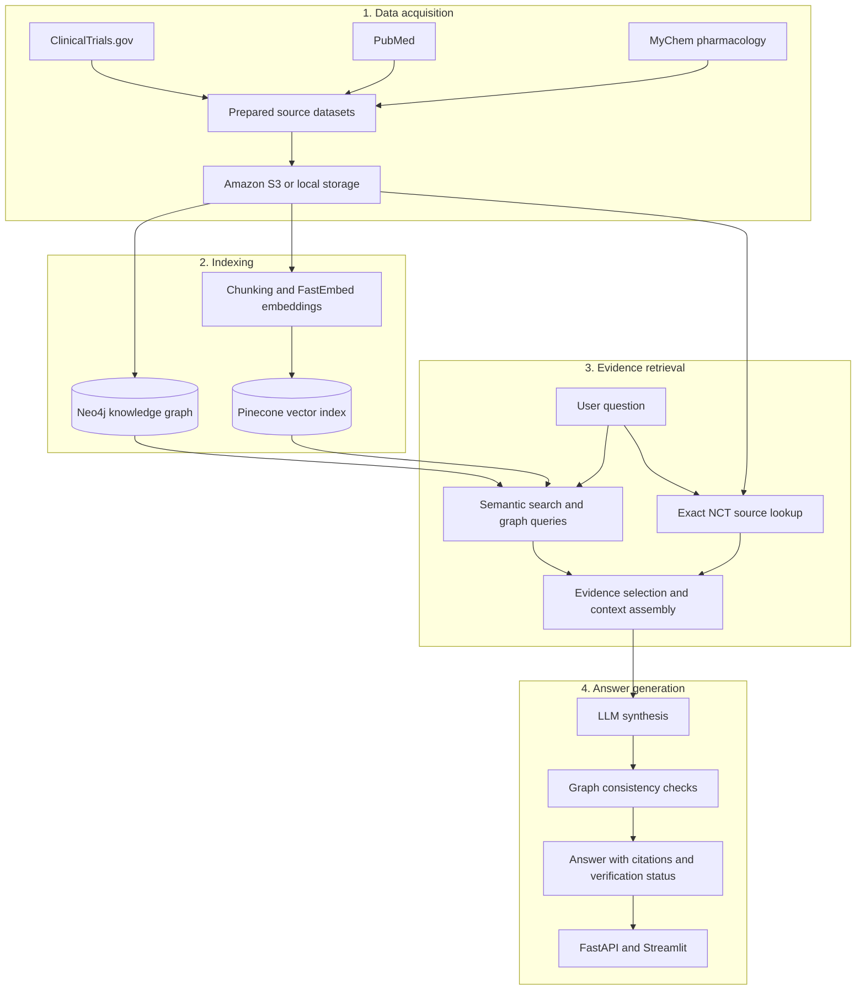

# Oncology Clinical Trial GraphRAG Copilot

An AI assistant for exploring oncology clinical trials, scientific literature, and
pharmacology data, focused on **EGFR-related non-small-cell lung cancer**. It combines
semantic search with structured graph queries to generate answers with source citations.

**Status:** actively in development on AWS EC2, with Amazon S3 support for source data
storage. The application has not yet been deployed for end users.

## Features

- **Data pipeline:** collect and prepare data from ClinicalTrials.gov, PubMed, and MyChem.
- **Hybrid retrieval:** combine Pinecone semantic search with Neo4j relationships between trials, treatment arms, drugs, and genes.
- **Exact trial lookup:** prioritize source records when a question includes an NCT identifier.
- **Sourced answers:** assemble evidence for the LLM and check selected trial identifiers and drug–gene relationships against the graph.
- **API and interface:** FastAPI endpoints and a Streamlit interface for exploring results.
- **Observability and evaluation:** local traces, optional LangSmith tracing, retrieval benchmarks, and Ragas answer evaluation.

## Architecture



**Stack:** Python · Neo4j / Cypher · Pinecone · FastEmbed · FastAPI · Streamlit · AWS EC2 / S3 · Pytest · Ragas · LangSmith

## Getting started

Install dependencies with Python 3.11+ and [uv](https://docs.astral.sh/uv/):

```bash
uv sync --extra eval
```

Create a `.env` file in the repository root with your service configuration:

```dotenv
NEO4J_URI=neo4j+s://YOUR_INSTANCE
NEO4J_USERNAME=YOUR_USERNAME
NEO4J_PASSWORD=YOUR_PASSWORD
VECTOR_STORE_PROVIDER=pinecone
PINECONE_API_KEY=YOUR_API_KEY
PINECONE_INDEX_NAME=clinical-trial-copilot
PINECONE_NAMESPACE=oncology-bge-small-v1
EMBEDDING_PROVIDER=fastembed
OPENAI_API_KEY=YOUR_API_KEY

# Optional: source storage on S3 instead of local data/output
# RAG_DATA_S3_URI=s3://YOUR_BUCKET/datasets/oncology
# AWS_DEFAULT_REGION=eu-west-3
```

Use the same index, namespace, and embedding configuration for ingestion and serving.
S3 access requires the AWS CLI and credentials, such as an EC2 IAM role with access
to the selected prefix. Without an LLM API key, the application uses a local template fallback.

For initial data preparation, run the following commands. Acquisition writes source
files; the next two commands populate the configured graph and vector indexes.

```bash
uv run python -m clinical_trial_rag_copilot.data.run_acquisition
uv run python -m clinical_trial_rag_copilot.graph.ingest
uv run python -m clinical_trial_rag_copilot.retrieval.vector_store
```

Launch the API and interface in separate terminals:

```bash
uv run uvicorn clinical_trial_rag_copilot.api.main:app --port 8000
uv run streamlit run src/clinical_trial_rag_copilot/app/ui.py
```

API documentation: `http://localhost:8000/docs` · Interface: `http://localhost:8501`

## Evaluation and ongoing work

```bash
uv run --extra eval python -m pytest -q
```

The last documented validation on **November 16, 2026** passed **108 automated tests**.
A five-question Ragas pilot helped improve exact trial lookup and answer focus:
the requested trial appeared in the top three results in **5/5 cases**, up from **4/5**.
These are development results on a small sample, not clinical validation.

Current work focuses on entity extraction, broader independently reviewed evaluations,
and eligibility-criteria analysis. The experimental `/api/v1/match` endpoint returns
candidate trials and source eligibility sections; it does not determine complete
patient eligibility.

- [Architecture and development roadmap](docs/design/oncology-graphrag.md)
- [Criterion review: usage and current scope](docs/design/criterion-review-usage.md)
- [Retrieval evaluation](eval/README.md)
- [Ragas pilot results and limitations](eval/ragas_pilot_comparison.md)
